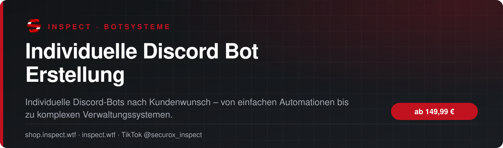
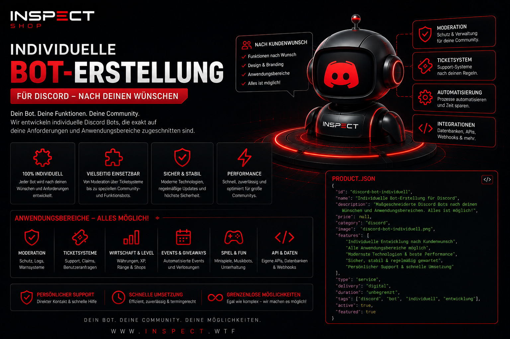

<!-- inspect-showcase: automatisch erzeugt, Änderungen bitte im Shop vornehmen -->

  
  
  

  
  
  

 

> 🇬🇧 **English:** Individuelle Discord Bot Erstellung – custom Discord bots and automation (service) by SecuroX Inspect. Purchase and licensing exclusively at [shop.inspect.wtf](https://shop.inspect.wtf). Product details below are in German – questions are welcome on [Discord](https://discord.gg/inspect).

 

## Das Wichtigste auf einen Blick

<table>
  <tr>
    <td width="50%" valign="top">✔&nbsp; <b>Individuelle Entwicklung nach Kundenwunsch</b></td>
    <td width="50%" valign="top">✔&nbsp; <b>Community-, Support-, Ticket- und Moderationssysteme</b></td>
  </tr>
  <tr>
    <td width="50%" valign="top">✔&nbsp; <b>Whitelist-, Rollen-, Log- und Verwaltungssysteme</b></td>
    <td width="50%" valign="top">✔&nbsp; <b>FiveM-, Shop-, Lizenz- und API-Integrationen</b></td>
  </tr>
</table>

## Überblick

Wir entwickeln deinen Discord-Bot individuell nach deinen Anforderungen und deinem gewünschten Einsatzbereich. Ob Community-Verwaltung, Support, Tickets, Moderation, Whitelist, Logs, Shop- und Lizenzanbindungen, API-Integrationen, FiveM-Systeme, Statistiken, Rollenverwaltung, automatische Abläufe oder vollständig eigene Funktionen: Das Projekt wird passend zu deinem Anwendungsfall geplant und umgesetzt. Vor Beginn werden Funktionsumfang, Schnittstellen und gewünschtes Verhalten gemeinsam abgestimmt.

## Kompatibilität

| | |
|:--|:--|
| Plattform | FiveM (GTA V) |

## Alle weiteren Funktionen

- Datenbankanbindungen und automatisierte Abläufe
- Slash Commands, Buttons, Modals und moderne Discord-Oberflächen
- Innovative Community spiele und Events
- Statistiken, Dashboards, Benachrichtigungen und Webhooks
- Bestehende Systeme können angebunden oder erweitert werden
- Projektumfang und Funktionen werden vor Entwicklungsstart abgestimmt
- STARTER · 149,00 € – Für klassische Discord-Systeme mit überschaubarem Funktionsumfang, z. B. Moderation, Tickets, Logs, Rollenverwaltung oder einfache Automatisierungen.
- PROFESSIONAL · 199,99 € – Für umfangreichere Systeme mit mehreren Modulen, Datenbankanbindung, API-Schnittstellen, FiveM-Integration und komplexeren Automatisierungen.
- FULL SERVICE · 299,99 € – Für anspruchsvolle Komplettlösungen mit individueller Entwicklung, Hosting, Community-Systemen, Spielen, Statistiken, Integrationen und weiteren abgestimmten Funktionen.
- Der genaue Leistungsumfang wird vor Entwicklungsbeginn gemeinsam abgestimmt

## Preis

| Paket | Leistungsumfang | Preis |
|:--|:--|--:|
| **STARTER** | Für klassische Systeme | **149,99 €** |
| **PROFESSIONAL** | Für umfangreichere Systeme mit mehreren Modulen | **199,99 €** |
| **FULL SERVICE** | Für anspruchsvolle Komplettlösungen | **299,99 €** |

Sichere Zahlung mit PayPal oder Kreditkarte · Rechnung als PDF · Support auf Deutsch

## So läuft die Beauftragung ab

1. **Im Shop buchen** – sicher bezahlen mit PayPal oder Kreditkarte.
2. **Persönliche Abstimmung** – wir klären Umfang, Wünsche und Ablauf direkt mit dir.
3. **Umsetzung & Übergabe** – mit festem Ansprechpartner über Discord.

## Warum INSPECT?

<table>
  <tr>
    <td width="50%" valign="top"><b>🇩🇪 Entwickelt in Deutschland</b> Konzeption, Entwicklung und Support aus einer Hand.</td>
    <td width="50%" valign="top"><b>💬 Persönlicher Support</b> Schnelle Hilfe auf Deutsch im INSPECT Discord.</td>
  </tr>
  <tr>
    <td width="50%" valign="top"><b>🔒 Sichere Zahlung</b> PayPal oder Kreditkarte, Rechnung automatisch als PDF.</td>
    <td width="50%" valign="top"><b>🤝 Individuelle Abstimmung</b> Leistungsumfang wird vor Beginn gemeinsam festgelegt.</td>
  </tr>
</table>

## Häufige Fragen

<b>Wie läuft die Beauftragung ab?</b>

 

Nach der Buchung im Shop melden wir uns bei dir und stimmen Umfang, Inhalte und Zeitplan gemeinsam ab.

<b>Kann ich vorher Fragen stellen?</b>

 

Ja – schreib uns einfach im [INSPECT Discord](https://discord.gg/inspect) oder per E-Mail an [info@inspect.wtf](mailto:info@inspect.wtf).

<b>Wo kaufe ich offiziell?</b>

 

Ausschließlich im INSPECT Shop unter [shop.inspect.wtf](https://shop.inspect.wtf). Angebote von Dritten stammen nicht von uns.

## Kontakt

| | |
|:--|:--|
| 🛒 Shop | [shop.inspect.wtf](https://shop.inspect.wtf) |
| 🌐 Website | [inspect.wtf](https://inspect.wtf) |
| 💬 Discord | [discord.gg/inspect](https://discord.gg/inspect) |
| 🎬 TikTok | [@securox_inspect](https://www.tiktok.com/@securox_inspect) |
| ✉️ E-Mail | [info@inspect.wtf](mailto:info@inspect.wtf) |

---

<b>SecuroX Inspect</b> · Offizielle Produktpräsentation · Dieses Repository enthält keinen Quellcode und keine Produktdateien. 
Kauf und Lizenzen ausschließlich über <a href="https://shop.inspect.wtf">shop.inspect.wtf</a> · Inhalte werden automatisch aus dem Shop aktualisiert.

